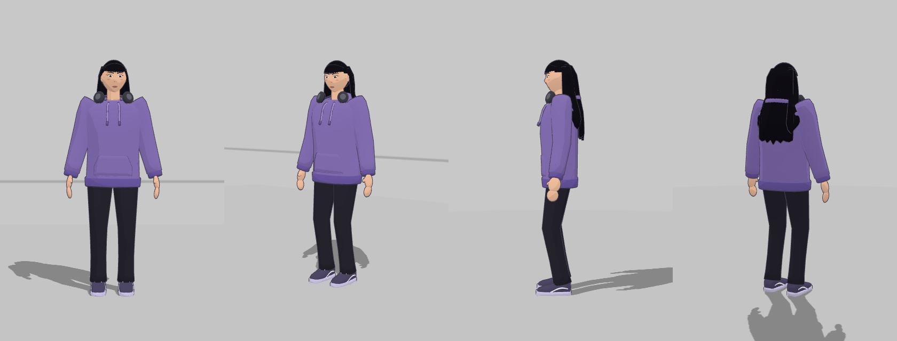

# Alecsia 3D — Pe Sub Mână

Model 3D rig-uit al Alecsiei, cu fața animabilă și 13 animații. E construit după turnaround-ul de referință
([`../referinta/alecsia-turnaround.jpg`](../referinta/alecsia-turnaround.jpg)), în stil cel-shaded:
- hanorac mov supradimensionat cu glugă, șnururi și buzunar cangur;
- căști gri închis la gât;
- păr negru lung și drept, cu breton franjurat;
- eyeliner „wing”, sprâncene groase;
- blugi negri și teniși mov cu talpă lila și dungă albă;
- laptop gri cu stickere.



## Cum îl vezi

- **În browser:** deschide `alecsia/3d/index.html`. Merge și cu dublu-click, fără server și fără instalare, pentru că datele sunt incluse în `models/data.js`. Ai toon shading cu contur, aceleași decoruri ca la animațiile 2D (stradă, drum, cameră, piscină) și mașina și biroul sincronizate cu animațiile. Camera se rotește cu mouse-ul.
- **În Blender (5.x):** deschide `models/alecsia.blend`. Fiecare animație e o acțiune separată (`ALX_<Clip>` pentru schelet, `ALX_<Clip>_face` pentru expresii), pe care o alegi din *Action Editor*. Pistele NLA cu toate clipurile sunt și ele în fișier, dezactivate (mute).
- **În Unity / Unreal / Godot:**
  - `models/alecsia.glb` (glTF 2.0) conține scheletul, skinning-ul, morph targets și toate clipurile.
  - `models/alecsia.fbx` conține fiecare clip ca *take* separat.
  - `models/car.glb` și `models/desk.glb` sunt recuzita. Clipurile mașinii au aceleași nume ca ale personajului (`CarEnter`, `Drive`, `CarExit`), așa că le pornești în același timp.

## Animații (30 fps)

| Clip | Ce face | Buclă | Durată | Decor |
|---|---|---|---|---|
| `Idle` | stă, respiră, își mută greutatea, clipește | da | 4 s | studio |
| `Talk` | vorbește: lip-sync din morph-uri, gesturi cu mâna, ridică sprâncenele | da | 6 s | studio |
| `Wave` | salută cu mâna și zâmbește | da | 2.4 s | studio |
| `Walk` | merge (pe loc, ~1.6 m/s) | da | 1.1 s | stradă |
| `WalkLaptop` | merge cu laptopul ținut lângă șold | da | 1.15 s | stradă |
| `Run` | aleargă (pe loc, ~4.7 m/s) | da | 0.66 s | stradă |
| `Jump` | sare: anticipare, zbor, aterizare | da | 1.8 s | studio |
| `SitDown` | se așază la birou și pune mâinile pe tastatură | nu | 2.6 s | cameră + birou |
| `Type` | tastează la laptop (cu o pauză în care se uită în altă parte) | da | 4 s | cameră + birou |
| `CarEnter` | vine pe trotuar, deschide ușa, se așază pe scaun, bagă picioarele, închide ușa, pune mâinile pe volan | nu | 6.6 s | stradă + mașină |
| `Drive` | conduce: volanul se rotește, mâinile îl urmăresc, se uită în oglindă, mașina se zdruncină | da | 6 s | drum + mașină |
| `CarExit` | deschide ușa, scoate picioarele, iese, închide ușa, se întoarce și pleacă | nu | 7.2 s | stradă + mașină |
| `Swim` | înoată craul, cu rotirea corpului, respirație pe lateral și forfecare din picioare | da | 1.6 s | piscină |

Previzualizări GIF: [`preview/`](preview/).

### Poziționarea în scenă

- Personajul are originea la sol, între picioare, și privește spre −Y (în Blender) sau +Z (în glTF).
- Mașina stă la **(−1.25, 0, 0)** față de originea personajului (în Blender). Valoarea e trecută și în `models/clips.json` (`car_position`). În `car.glb` mașina e deja la poziția asta.
- Biroul și scaunul din `desk.glb` sunt deja la poziția folosită de `SitDown` / `Type`.
- `Walk`, `WalkLaptop`, `Run`, `Swim` și `Drive` sunt „pe loc”. Viteza cu care trebuie să se deplaseze decorul (sau personajul) e în `models/clips.json` (`speed`, în m/s). E calculată după talpa de sprijin, ca picioarele să nu alunece.
- `Swim` presupune suprafața apei la înălțimea 0.

## Rig

- **Oase:** `Root`, `Hips`, `Spine`, `Chest`, `Neck`, `Head`, `HairBack1-2` (părul din spate),
  `Shoulder/UpperArm/ForeArm/Hand/Fingers .L/.R`, `UpLeg/Leg/Foot/Toe .L/.R`, plus `Laptop.R` (laptopul cărat; are scale 0 când nu e folosit).
- **Morph targets / shape keys pe `Alecsia_Face`:** `blink`, `mouth_open`, `mouth_O`, `mouth_E`, `smile`, `brow_up`, `brow_angry`.
- **Poza de repaus:** A-pose (brațele la 50°), potrivită pentru retargeting.

## Cum regenerezi totul

Totul e generat procedural din cod, în `src/`:
- `alecsia_model.py`: corpul, hainele, părul, fața, scheletul, weights;
- `alecsia_anims.py`: animațiile, cu FK și IK pe 2 oase;
- `props_model.py`: mașina, biroul, laptopul;
- `build.py`: exportul.

Ca să schimbi o culoare, o proporție sau o animație, editezi codul și rulezi:

```bash
pip install bpy
python3 alecsia/3d/src/build.py
node tools/preview-alecsia-3d.js
```

Rulează-le în ordinea de mai sus. Prima comandă instalează Blender ca modul Python. A doua generează `.blend`, `.glb`, `.fbx` și datele viewer-ului în `models/`. A treia regenerează GIF-urile; are nevoie de Playwright și `ffmpeg`.

Viewer-ul (`viewer-src/main.js`) se recompilează cu `./build-viewer.sh` (are nevoie de npm: three + esbuild).

## Limitări

- Materialele din `.blend` / `.glb` sunt culori plate (PBR simplu). Aspectul de desen animat (umbre în trepte și contur negru) vine din viewer. Într-un engine îl obții cu un shader toon și un outline de tip „inverted hull”.
- Mâinile sunt stilizate: palmă, bloc de degete și deget mare, cu un singur os pentru degete. Nu pot fi animate deget cu deget.
- Trăsăturile feței sunt geometrie lipită pe cap, animată din shape keys. Gura nu are o cavitate 3D reală.
