# Alecsia — Pe Sub Mână

Personaj 2D animat, construit ca **rig vectorial (SVG + JavaScript)** pornind de la turnaround-ul de referință
([`referinta/alecsia-turnaround.jpg`](referinta/alecsia-turnaround.jpg)). Păstrează trăsăturile și stilul grafic din referință:
contur negru gros (stil benzi desenate), culori plate cu umbre cel-shaded, păr negru lung și drept cu breton franjurat,
eyeliner „wing”, hanorac mov supradimensionat cu glugă și buzunar cangur, căști gri închis la gât, blugi negri,
teniși mov cu talpă lila și dungă albă, laptop gri plin de stickere.

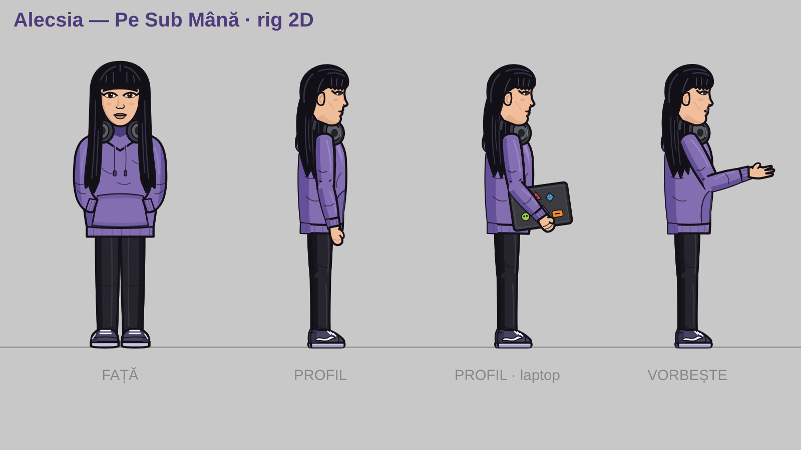

## Cum le vezi

Deschide **`alecsia/index.html`** în browser (merge direct din fișier, fără server, fără instalare).
Din viewer poți alege animația, reda pas cu pas, schimba viteza, ascunde fundalul și exporta
cadre PNG/SVG sau sprite sheet-uri (PNG + JSON).

Taste: `Spațiu` play/pauză · `←` `→` cadru cu cadru · `↑` `↓` animația anterioară/următoare.

## Animații

| Grup | Animație | ID | Buclă | Durată |
|---|---|---|---|---|
| De bază | Stă (idle), profil | `idle` | da | 4 s |
| De bază | Stă, din față | `idleFront` | da | 4 s |
| Vorbit | Vorbește, din față (lip-sync, sprâncene, clipit) | `talkFront` | da | 6 s |
| Vorbit | Vorbește, profil, cu gesturi | `talk` | da | 6 s |
| Deplasare | Merge | `walk` | da | 1.1 s |
| Deplasare | Merge cu laptopul sub braț | `walkLaptop` | da | 1.15 s |
| Deplasare | Aleargă | `run` | da | 0.66 s |
| Deplasare | Sare | `jump` | da | 1.8 s |
| Laptop | Se așază la birou | `sitDown` | nu | 2.6 s |
| Laptop | Tastează la laptop | `type` | da | 4 s |
| Mașină | Urcă în mașină (deschide ușa, intră, închide, mâinile pe volan) | `carEnter` | nu | 6.6 s |
| Mașină | Conduce (volan, roți, drum în mișcare) | `drive` | da | 6 s |
| Mașină | Coboară din mașină (deschide, iese, închide ușa, pleacă) | `carExit` | nu | 7.2 s |
| Apă | Înoată (craul) | `swim` | da | 1.6 s |

Previzualizări: [`export/preview/`](export/preview/) (GIF, cu fundal).

| | | |
|---|---|---|
| 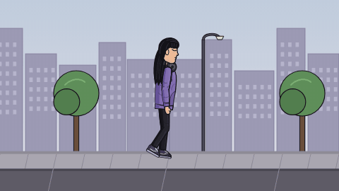 | 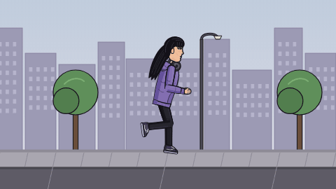 | 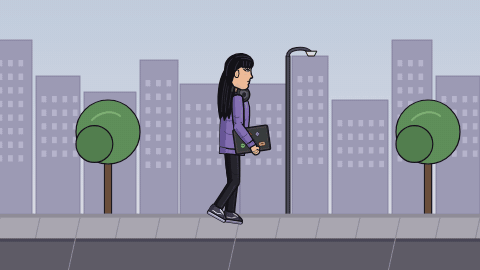 |
|  | 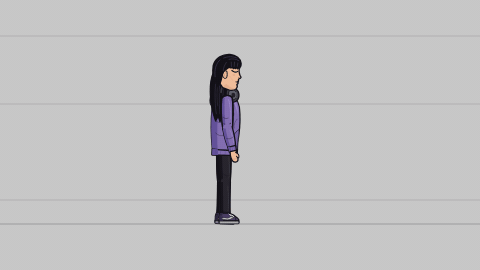 | 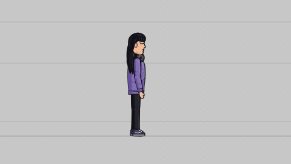 |
| 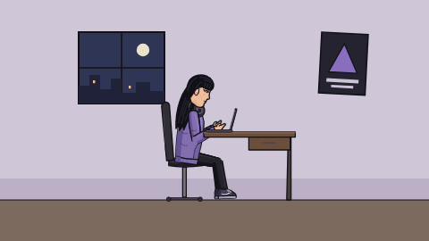 | 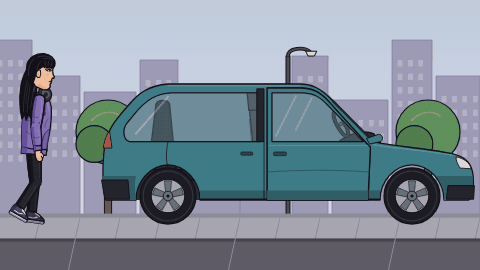 | 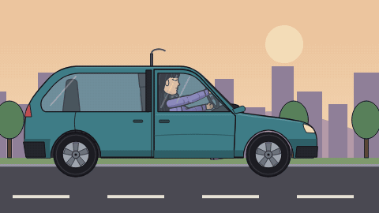 |
| 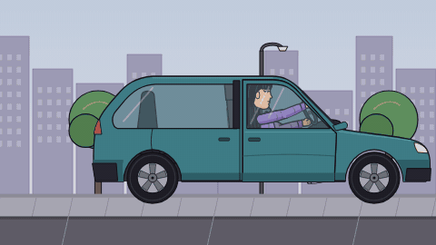 | 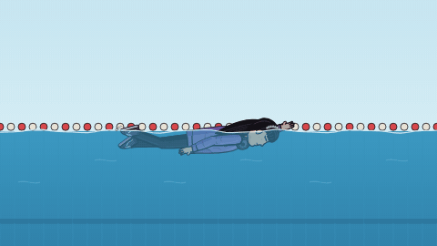 | 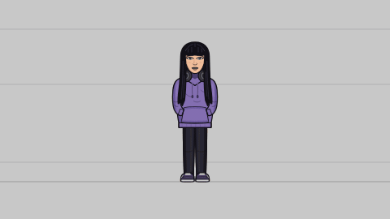 |

## Sprite sheet-uri (pentru joc / montaj)

În [`export/sprites/`](export/sprites/): câte un PNG transparent + un JSON pentru fiecare animație
(12 fps, celule de 480×270, 8 coloane). JSON-ul conține fps, durata, dacă e în buclă, poziția fiecărui cadru
și linia solului (`groundYpx`). Animațiile de mers și alergat sunt „pe loc”, iar decorul se derulează
calculat exact după talpa de sprijin, ca picioarele să nu alunece.

Le regenerezi (ex. la 24 fps sau mai mari) cu:

```bash
node tools/export-alecsia.js --fps 24 --cell 960
```

(necesită Playwright cu Chromium și `ffmpeg`; poți da și doar anumite ID-uri: `node tools/export-alecsia.js walk run`).

## Structura rig-ului

```
alecsia/
  index.html            viewer + export
  rig/core.js           paletă, helperi SVG, matrice, keyframe-uri, clipit, lip-sync
  rig/alecsia-side.js   rig din profil: schelet cu 17 oase, cinematică directă + IK cu 2 oase,
                        6 forme de mână, 3 stări de ochi, 6 forme de gură, sprâncene, păr cu os propriu
  rig/alecsia-front.js  vedere din față: respirație, cap, ochi + privire, 6 forme de gură, sprâncene
  rig/props.js          mașină (caroserie / interior / ușă care se deschide / roți / volan), laptop,
                        birou, scaun, apă
  rig/stage.js          fundaluri cu parallax (studio, stradă, drum, cameră, piscină) și straturi de adâncime
  rig/animations.js     toate animațiile
  rig/export.js         export PNG / SVG / sprite sheet
```

### Poza (pose) — rig din profil

Unghiuri în grade: membre `> 0` = spre față; `torso` / `head` `> 0` = aplecat în față; `shin*` `< 0` = genunchi îndoit;
`fArm*` `> 0` = cot îndoit; `foot*` `> 0` = vârful în sus; `hair` `> 0` = părul flutură în spate.

```js
{ x, y, facing: 1|-1, root, torso, head, hair,
  thighF, shinF, footF, thighB, shinB, footB,
  uArmF, fArmF, handF, uArmB, fArmB, handB,
  handShapeF / handShapeB: 'relaxed'|'fist'|'open'|'grip'|'type'|'point',
  eyes: 'open'|'half'|'closed',
  mouth: 'closed'|'small'|'wide'|'o'|'e'|'smile',
  brow, ground /* lipește automat talpa de sol */, lift /* înălțime peste sol */ }
```

O animație nouă înseamnă o intrare nouă în `rig/animations.js`:

```js
def({ id: 'wave', label: 'Face cu mâna', group: 'Gesturi', T: 2, loop: true,
  frame(t, ctx) { return { bg: 'studio', pose: { ...PSM.STAND, ground: 0, uArmF: 150, fArmF: 30 + 25 * Math.sin(t * 8) } }; } });
```
